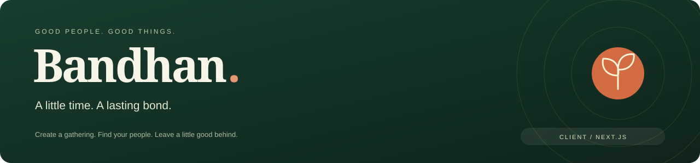
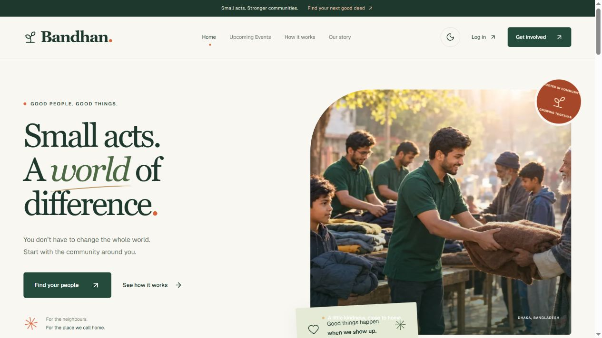
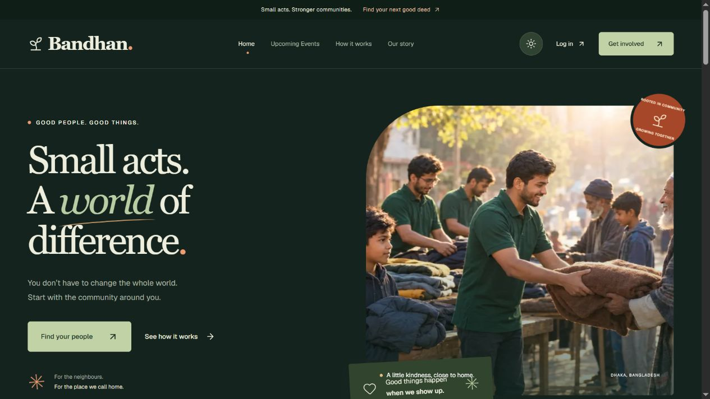
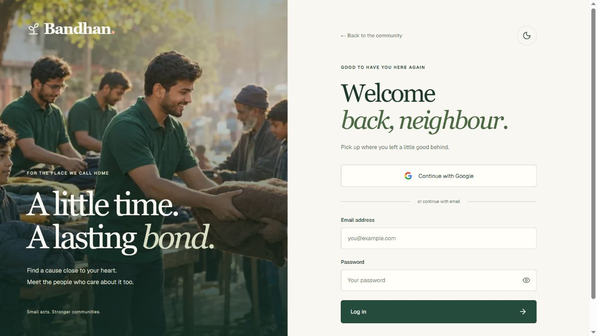
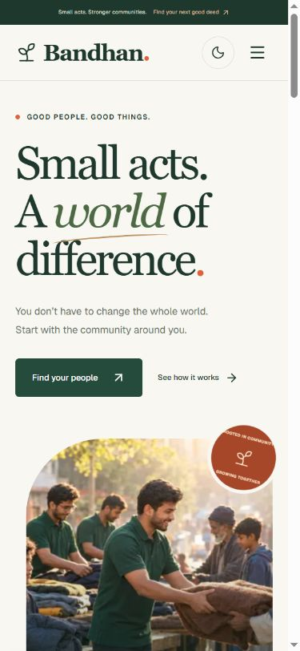
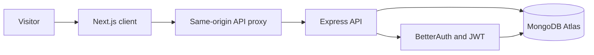

<div align="center">
  
  <p><strong>A community events platform for people who want to lend a hand close to home.</strong></p>
  <p>
    <a href="https://social-events-client-cyan.vercel.app"></a>
    <a href="https://github.com/rafidhasansydney/Social-Events-Server"></a>
  </p>
  <p>
    
    
    
    
    
    
  </p>
  <p><a href="#a-look-around">Screenshots</a> · <a href="#what-you-can-do">Features</a> · <a href="#run-it-locally">Setup</a> · <a href="#verification">Verification</a> · <a href="#assignment-submission">Submission links</a></p>
</div>

## 🌿 Meet Bandhan

Bandhan means a bond. The platform brings neighbours together through cleanups, plantation drives, donations, education, health and food initiatives. Members can organise a gathering, join another organiser's event and keep track of their contribution.

**Live website:** [social-events-client-cyan.vercel.app](https://social-events-client-cyan.vercel.app)

বাংলায় ব্যবহার ও Git Bash নির্দেশনা: [Bandhan ব্যবহার করার নিয়ম](USAGE.bn.md).

<a name="a-look-around"></a>

## 📸 A look around

Real browser screenshots of Bandhan. Images are stored in this repository so the preview travels with the project.



<table>
  <tr>
    <td width="50%"><strong>Evenings in dark mode</strong><br /></td>
    <td width="50%"><strong>A welcoming sign-in</strong><br /></td>
  </tr>
</table>

<details>
  <summary><strong>Open the mobile preview</strong></summary>
  <p>Navigation, typography and imagery adapt to a narrow screen.</p>
  
</details>

<a name="what-you-can-do"></a>

## ✨ What you can do

- **Find a cause nearby.** Browse future events, filter by six causes and search by title or meeting location.
- **See what is happening next.** The homepage loads up to six upcoming events from MongoDB using `.limit(6)`, ordered by event date.
- **Join the community.** Register with email and password or sign in with Google through BetterAuth.
- **Start something good.** Create an event with a description, cause, location, photo and future date/time.
- **Bring your own photos.** Select JPG, PNG or WebP from your phone or computer, up to 4 MB. An image-link option is also available.
- **Manage your gatherings.** Edit your own events and confirm deletion from Manage Events. Organisers see management controls on their own event details.
- **Keep your plans together.** Joined Events lists participation in date order and provides All, Upcoming and Past views.
- **Make yourself at home.** Edit your profile name, photo, area and short bio.
- **Choose your atmosphere.** Switch the full site between light and dark; the choice persists after reload and between tabs.
- **Share a good thing.** Copy an event link. Loading skeletons, image fallbacks, retry actions and clear empty states keep the journey understandable.

The newsletter is a design-only section, as requested by the assignment. Event listings use saved data; create future events to populate the homepage.

## 🧭 Pages and access

| Page | Route | Access |
|---|---|---|
| Home | `/` | Public |
| Upcoming events | `/upcoming-events` | Public |
| Event details | `/events/[id]` | Public; joining requires login |
| Login / Register | `/login`, `/register` | Public |
| Profile | `/account` | Signed-in members |
| Create event | `/create-event` | Signed-in members |
| Manage events | `/manage-events` | Current organiser's events |
| Edit event | `/manage-events/[id]/edit` | Event owner |
| Joined events | `/joined-events` | Current member's participation |

A visitor who needs to log in returns to the requested page afterward. The API independently verifies sessions, JWTs and event ownership. Repeated joins produce one participation record; organisers cannot join their own events.

## 🛠️ Built with

| Layer | Tools |
|---|---|
| Interface | Next.js App Router, React, JavaScript |
| Styling | Tailwind CSS, DaisyUI buttons, custom CSS |
| Motion and icons | Framer Motion, Lucide |
| Authentication | BetterAuth, Google OAuth, JWT |
| Feedback and themes | React Hot Toast, next-themes |
| Hosting | Vercel client, Render API, MongoDB Atlas |



<a name="run-it-locally"></a>

## 🚀 Run it locally

Use Node.js 24 and npm. Start the [backend](https://github.com/rafidhasansydney/Social-Events-Server#run-it-locally) first. In Git Bash:

```bash
git clone https://github.com/rafidhasansydney/Social-Events-Client.git
cd Social-Events-Client
npm ci
cp .env.example .env.local
npm run dev
```

Open [localhost:3000](http://localhost:3000).

| Client environment variable | Local value | Purpose |
|---|---|---|
| `API_URL` | `http://localhost:5000` | Destination for the Next.js `/api/*` proxy |

Google and database credentials belong in the backend environment. The client uses the same-origin proxy for API requests and session cookies.

## ☁️ Deployment and Google Login

| Setting | Value |
|---|---|
| Vercel repository / branch | This repository / `main` |
| Framework / root | Next.js / `./` |
| Vercel `API_URL` | `https://social-events-server-yvf5.onrender.com` |
| Render `CLIENT_URL` | `https://social-events-client-cyan.vercel.app` |
| Render `BETTER_AUTH_URL` | `https://social-events-client-cyan.vercel.app` |

Register these values on the Google OAuth web client:

| Environment | JavaScript origin | Redirect URI |
|---|---|---|
| Local | `http://localhost:3000` | `http://localhost:5000/api/auth/callback/google` |
| Live | `https://social-events-client-cyan.vercel.app` | `https://social-events-client-cyan.vercel.app/api/auth/callback/google` |

The app requests only `openid`, `email` and `profile`. See Google's [audience guidance](https://support.google.com/cloud/answer/15549945?hl=en) for the basic sign-in exception to Testing-mode restrictions. Email verification and password reset are intentionally omitted for this assignment.

Render's free service can sleep while idle, so the first API response may take longer. Uploaded photos live in MongoDB rather than the hosting filesystem.

<a name="verification"></a>

## ✅ Verification

| Command | Purpose |
|---|---|
| `npm run lint` | ESLint checks |
| `npm run build` | Production compilation and route generation |
| `npm start` | Serve a completed production build |

The review on **5 November 2026** passed lint and the production build. Browser review found and fixed a narrow-screen header overflow; the updated layout was checked at 320px and 390px. Public API checks covered readiness, anonymous access protection, CORS and malformed event IDs.

See the [verification report](docs/VERIFICATION.md) for results and limits, including the local Atlas connection restriction during the full authenticated workflow check.

## 📁 Project map

```text
app/          Pages, metadata, root layout and global styles
components/   Navigation, forms, event views, profile and feedback
lib/          API access, authentication, event validation and uploads
public/       Site images and public assets
docs/         Screenshots and verification notes
```

<a name="assignment-submission"></a>

## 📎 Assignment submission

| Required item | Link |
|---|---|
| Live site | [Bandhan](https://social-events-client-cyan.vercel.app) |
| Client repository | [Social-Events-Client](https://github.com/rafidhasansydney/Social-Events-Client) |
| Server repository | [Social-Events-Server](https://github.com/rafidhasansydney/Social-Events-Server) |

Built by [Rafid Hasan Sydney](https://github.com/rafidhasansydney) for the Social Development Events Platform assignment.
